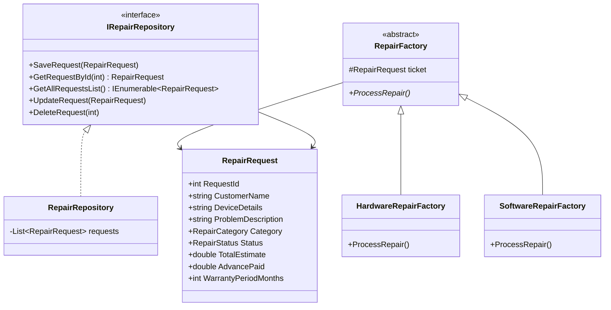

# Computer Repair Store Management System (C# & Design Patterns)


An enterprise console application demonstrating clean object-oriented architecture and the implementation of classic Gang of Four (GoF) design patterns in C#. The system manages diagnostic tickets, hardware/software pricing algorithms, warranty allocation, VAT calculations, advance tokens, and complete ticket lifecycles.

---

## 🌟 Key Features & Design Patterns

### 1. Factory Pattern (`Factory/`)
- **`RepairFactory` (Abstract Base):** Declares template repair processing operations.
- **`HardwareRepairFactory`:** Dynamically instantiates hardware diagnostic workflows, base component replacement fees, and enforces a **3-month hardware warranty**.
- **`SoftwareRepairFactory`:** Instantiates OS/software troubleshooting workflows, license validation, and enforces a **1-month software warranty**.

### 2. Repository Pattern (`Repositories/`)
- **`IRepairRepository` (Contract Interface):** Decouples business logic from in-memory or database persistence (`SaveRequest`, `GetRequestById`, `GetAllRequestsList`, `UpdateRequest`, `DeleteRequest`).
- **`RepairRepository`:** Concrete implementation managing data operations with thread-safe list operations.

### 3. Business Rules & Financial Accounting
- **Tax & Discount Processing:** Applies holiday/device promotional discounts (10% on Laptops/MacBooks) and automatically computes standard **5% VAT**.
- **Balance Due Tracking:** Real-time reconciliation between total estimate, advance tokens, and remaining balance due.
- **ASCII Dashboard:** Polished ASCII terminal dashboard with status labels (`Pending`, `InProgress`, `Handed Over`).

---

## 🏗️ Class Diagram & Architecture



---

## 📂 Project Structure

```
ComputerRepairStoreManagement/
├── Entities/
│   ├── RepairEnums.cs            # RepairCategory (Hardware, Software), RepairStatus
│   └── RepairRequest.cs          # Core domain entity model
├── Factory/
│   ├── RepairFactory.cs          # Abstract factory base
│   ├── HardwareRepairFactory.cs  # Hardware repair calculator & warranty assigner
│   └── SoftwareRepairFactory.cs  # Software repair calculator & warranty assigner
├── Manager/
│   ├── IRepairManager.cs         # Manager contracts
│   ├── HardwareRepairManager.cs  # Component diagnostics
│   └── SoftwareRepairManager.cs  # System diagnostics
├── Repositories/
│   ├── IRepairRepository.cs      # CRUD interface abstraction
│   └── RepairRepository.cs       # Repository persistence layer
├── Program.cs                    # CLI runner, menus, VAT calculation & dashboard
└── ComputerRepairStoreManagement.csproj
```

---

## ⚙️ Running Locally

1. Open the solution in **Visual Studio 2022**:
   ```
   ComputerRepairStoreManagement_1294926.sln
   ```
2. Build the solution (`Ctrl + Shift + B`).
3. Press `F5` or `Ctrl + F5` to run the console dashboard.

---

## 👤 Author
**A.H.M. Zafir Hasan**  
Trainee ID: `1294926` | Batch: `CS/SCSL-A/70/01`  
- **GitHub:** [@Zafff-e](https://github.com/Zafff-e)  
- **Portfolio:** [zafff-e.github.io](https://zafff-e.github.io)  
- **LinkedIn:** [zafir-hasan-developer](https://linkedin.com/in/zafir-hasan-developer)
