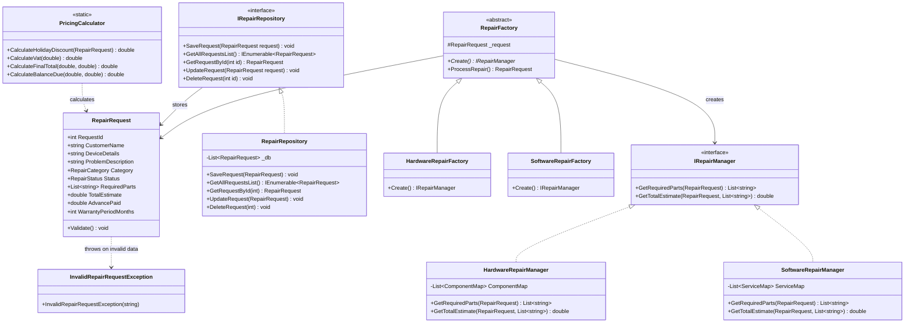

# Computer Repair Store Management System

[](https://dotnet.microsoft.com/)
[](https://refactoring.guru/design-patterns)
[-success?logo=xunit&logoColor=white)](https://xunit.net/)
[](#architecture--design-patterns)
[](LICENSE)

An enterprise diagnostic, ticketing, and accounting management console application written in C#. Designed to showcase core Object-Oriented Programming (OOP) excellence, Gang of Four (GoF) design patterns (**Factory Method** and **Repository Pattern**), modular business logic, domain validation exceptions, and automated unit testing via **xUnit**.

---

## 1. Domain Problem & System Overview

Computer repair workshops handle high volumes of heterogeneous service requests ranging from physical hardware replacements (screens, batteries, motherboards) to operating system and software remediation (malware decontamination, OS clean installs, data recovery).

Without a structured software architecture, service shops struggle with:
- **Inconsistent pricing and diagnostic fees:** Component costs and labor rates are frequently misquoted.
- **Warranty ambiguity:** Different repair categories carry different liability obligations (e.g., 3-month hardware warranty vs. 1-month software warranty).
- **Financial reconciliation errors:** Inaccurate calculations of promotional device discounts (e.g., 10% off laptop services), sales tax (5% VAT), and advance token deductions.

This system provides a structured terminal dashboard for technicians and front-desk personnel to intake customer repair requests, automatically resolve diagnostic component pricing, enforce category warranties, compute tax/discounts, and manage full ticket lifecycles (Pending -> In Progress -> Handed Over).

---

## 2. Architecture & Design Patterns

The solution is architected according to SOLID principles, completely isolating business logic, data persistence, and user interface layers.



### A. Factory Method Pattern (`Factory/`)
- **`RepairFactory` (Abstract Creator):** Declares the factory method `Create()` returning an `IRepairManager`, alongside a concrete template method `ProcessRepair()` which coordinates component resolution and cost calculation.
- **`HardwareRepairFactory`:** Instantiates `HardwareRepairManager`, sets the repair category to `Hardware`, and enforces a standard **3-month hardware warranty**.
- **`SoftwareRepairFactory`:** Instantiates `SoftwareRepairManager`, sets the repair category to `Software`, and enforces a **1-month software warranty**.
- *Design Benefit:* Eliminates switch/case statements in intake workflows. Adding new intake types (e.g., `MobileRepairFactory`) requires creating a new subclass without modifying existing factory code (Open/Closed Principle).

### B. Strategy / Manager Pattern (`Manager/`)
- **`IRepairManager` Contract:** Declares `GetRequiredParts()` and `GetTotalEstimate()`.
- **`HardwareRepairManager`:** Evaluates customer problem descriptions against a component knowledge map (`screen`, `battery`, `keyboard`, `motherboard`, `ram`, `ssd`, `fan`, `charger`, `wifi`). Injects base diagnostic labor (100 BDT) and automatically falls back to general component check (500 BDT) if no specific hardware keyword is identified.
- **`SoftwareRepairManager`:** Evaluates software symptoms against service remediation catalogs (`virus`, `malware`, `os`, `windows`, `reinstall`, `driver`, `recovery`, `bsod`, `startup`, `network`). Injects base software labor (60 BDT) with fallback system diagnostics (500 BDT).

### C. Domain Service & Financial Calculator (`Services/PricingCalculator.cs`)
Encapsulates all shop financial accounting:
1. **Promotional Discount:** 10% discount automatically applied to portable devices (`Laptop` or `MacBook`).
2. **Value Added Tax (VAT):** 5% VAT calculated on net taxable subtotal (`Subtotal - Discount`).
3. **Balance Due:** Real-time reconciliation subtracting `AdvancePaid` token from the finalized gross estimate.

### D. Repository Pattern (`Repositories/`)
- **`IRepairRepository` Interface:** Decouples domain operations from persistence mechanisms.
- **`RepairRepository`:** In-memory thread-safe implementation with seed records, auto-incrementing identity assignment, and full CRUD operations (`SaveRequest`, `GetAllRequestsList`, `GetRequestById`, `UpdateRequest`, `DeleteRequest`).

### E. Domain Validation & Custom Exception (`Exceptions/`)
- **`InvalidRepairRequestException`:** Custom domain exception thrown when data integrity rules are violated (empty customer name, blank device details, or negative advance payment).

---

## 3. Project Structure

```
ComputerRepairStoreManagement_1294926/
|-- ComputerRepairStoreManagement.sln          # Master solution (Console + Tests)
|-- ComputerRepairStoreManagement/             # Main Application Project (.NET Framework 4.8)
|   |-- Entities/
|   |   |-- RepairEnums.cs                     # Strongly typed RepairCategory & RepairStatus
|   |   +-- RepairRequest.cs                   # Domain entity with data validation
|   |-- Exceptions/
|   |   +-- InvalidRepairRequestException.cs   # Custom domain validation exception
|   |-- Factory/
|   |   |-- RepairFactory.cs                   # Abstract base factory (GoF Factory Method)
|   |   |-- HardwareRepairFactory.cs           # Concrete hardware factory
|   |   +-- SoftwareRepairFactory.cs           # Concrete software factory
|   |-- Manager/
|   |   |-- IRepairManager.cs                  # Strategy contract for diagnostics & parts
|   |   |-- HardwareRepairManager.cs           # Hardware diagnostic rules & catalog
|   |   +-- SoftwareRepairManager.cs           # Software diagnostic rules & catalog
|   |-- Repositories/
|   |   |-- IRepairRepository.cs               # Persistence abstraction interface
|   |   +-- RepairRepository.cs                # In-memory repository implementation
|   |-- Services/
|   |   +-- PricingCalculator.cs               # Financial service: discounts, 5% VAT, balance
|   |-- Properties/
|   |   +-- AssemblyInfo.cs                    # Assembly metadata
|   |-- Program.cs                             # Console dashboard, menus, & CLI workflows
|   |-- App.config                             # Application configuration
|   +-- ComputerRepairStoreManagement.csproj   # MSBuild project file
|-- ComputerRepairStoreManagement.Tests/       # xUnit Automated Test Suite (.NET 9 SDK)
|   |-- FactoryTests.cs                        # Factory instantiation & estimate tests (6 tests)
|   |-- PricingCalculatorTests.cs              # Discount, VAT & balance algorithm tests (16 tests)
|   |-- RepositoryTests.cs                     # Repository CRUD & auto-ID tests (6 tests)
|   |-- ValidationAndExceptionTests.cs         # Validation & enum boundary tests (5 tests)
|   +-- ComputerRepairStoreManagement.Tests.csproj
+-- README.md                                  # Enterprise engineering documentation
```

---

## 4. Automated Testing & Verification

The project includes an automated test suite implemented with **xUnit** and **Microsoft.NET.Test.Sdk**, executed directly via `dotnet test`.

### Test Results Summary
```bash
$ dotnet test ComputerRepairStoreManagement_1294926.sln

Passed!  - Failed: 0, Passed: 33, Skipped: 0, Total: 33, Duration: 697 ms
```

### Coverage Breakdown
| Test Suite File | Tests | Key Scenarios Verified |
| :--- | :---: | :--- |
| `FactoryTests.cs` | 6 | Verifies factory instantiation of managers, keyword resolution for hardware/software components, fallback item assignment, and category assignment. |
| `PricingCalculatorTests.cs` | 16 | Theory-driven tests verifying 10% promotional discount for Laptops/MacBooks, 0% discount for Desktops/Tablets, 5% VAT rate, final invoice formula, and balance due calculation. |
| `RepositoryTests.cs` | 6 | Seed record integrity, `GetById` matching, null returns for nonexistent IDs, auto-incrementing `SaveRequest`, in-place `UpdateRequest`, and `DeleteRequest`. |
| `ValidationAndExceptionTests.cs` | 5 | Boundary tests asserting `InvalidRepairRequestException` on blank names, missing devices, negative advance deposits, and verifying enum integer mappings. |

---

## 5. Getting Started & Running Locally

### Prerequisites
- **Visual Studio 2022** (Enterprise / Professional / Community) with .NET desktop development workload OR
- **.NET SDK 9.0+** (or .NET Framework 4.8 Developer Pack).

### Build & Run via Command Line

1. **Clone the repository:**
   ```bash
   git clone https://github.com/Zafff-e/CSharp-Design-Patterns-ComputerRepairStore.git
   cd CSharp-Design-Patterns-ComputerRepairStore
   ```

2. **Run all automated tests:**
   ```bash
   dotnet test ComputerRepairStoreManagement_1294926.sln
   ```

3. **Build the complete solution:**
   ```bash
   dotnet build ComputerRepairStoreManagement_1294926.sln
   ```

4. **Launch the interactive console dashboard:**
   ```bash
   dotnet run --project ComputerRepairStoreManagement/ComputerRepairStoreManagement.csproj
   ```

---

## 6. Technical Interview Talking Points

- **Why a console application for this demonstration?**
  Writing a console application deliberately eliminates web framework scaffolding (HTTP middleware, route controllers, CSS), allowing the hiring manager to evaluate raw C# language proficiency, design patterns, clean separation of concerns, and defensive data structures.
- **How does the Factory Method adhere to Open/Closed Principle (OCP)?**
  When the shop expands to service smart TVs or mobile devices, developers create a `MobileRepairFactory` implementing `RepairFactory` without touching or risking regressions in `HardwareRepairFactory` or `SoftwareRepairFactory`.
- **Why use the Repository Pattern with an in-memory store?**
  By coding to the `IRepairRepository` interface, the data persistence layer is completely decoupled. Migrating from in-memory lists to Entity Framework Core or ADO.NET SQL Server requires implementing a new `SqlRepairRepository` and swapping the dependency injection binding, leaving all business and factory logic untouched.
- **Handling 1-based UI prompts vs 0-based C# enums:**
  Enums (`RepairCategory` and `RepairStatus`) are explicitly declared with 1-based indexing (`Hardware = 1, Software = 2`), preventing off-by-one parsing mismatches when console users select numbered options.

---

## 7. Author & Scholarship Information

**A.H.M. Zafir Hasan**  
*Trainee ID:* `1294926` | *Batch:* `CS/SCSL-A/70/01`  
*Programme:* IsDB-BISEW IT Scholarship Programme (Round 70, ESAD-CS / WADA)  
- **GitHub:** [@Zafff-e](https://github.com/Zafff-e)  
- **Portfolio:** [zafff-e.github.io](https://zafff-e.github.io)  
- **LinkedIn:** [zafir-hasan-developer](https://linkedin.com/in/zafir-hasan-developer)
